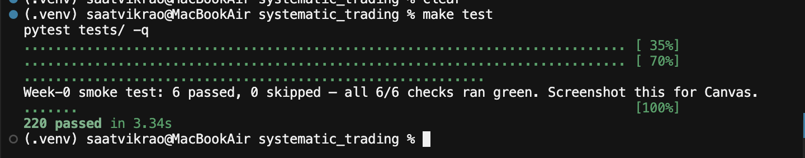
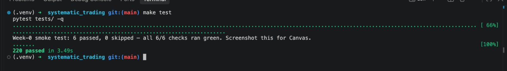
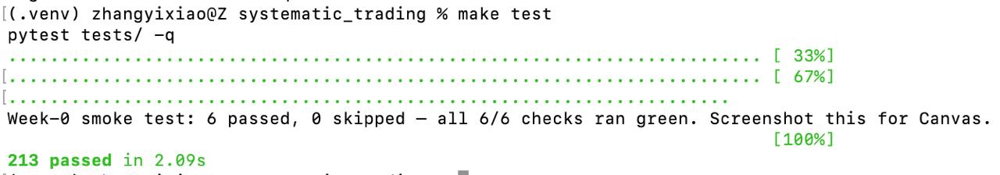
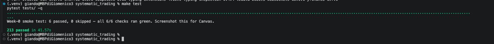

# Phase 0 — butter_chicken_pasta

**Team:** butter_chicken_pasta
**Members:** Saatvik Rao, Jacopo Michelacci, Yixiao Zhang, Giandomenico Porfidia
**Repo:** https://github.com/JacopoMichelacci/systematic_trading
**Seat ids:** `butter_chicken_pasta_trader_1`, `butter_chicken_pasta_trader_2`, `butter_chicken_pasta_trader_3`, `butter_chicken_pasta_broker`

## Roles and allocation

We put $250k into each of three trader seats and one broker desk, and didn't buy an exchange licence. The full reasoning is in [`ALLOCATION.md`](ALLOCATION.md).

| Who | Works on |
|---|---|
| Saatvik Rao, Yixiao Zhang | trading strategies for the three trader seats |
| Jacopo Michelacci, Giandomenico Porfidia | the broker's market-making strategy |

## UML

The class diagram, message-flow diagram and a README mapping each box to its file are in [`docs/uml/`](../docs/uml/).

Link: [docs/uml/](https://github.com/JacopoMichelacci/systematic_trading/tree/main/docs/uml)

## Level 1

Our bot (`team/trader.py`) buys one share of MSFT at the best ask after checking `portfolio.can_buy(...)`, then sits out. Here it is connecting and getting its `order_ack` on the class exchange:

```
15:48:01 INFO    trader.trader: Connected to wss://feed.algoarena-st.duckdns.org as butter_chicken_pasta_trader_1 (trader)
15:48:02 INFO    team.trader: Level 1 order 1/3: BUY 1 MSFT @ 408.38 (best ask)
15:48:02 DEBUG   trader.trader: Ack: buy 1 MSFT @ 408.3800
15:48:02 INFO    trader.trader: Fill: bought 1 MSFT @ 408.3800 (fee=0.6126)
```

## Tests

Each of us ran `make test` on our own machine, with our `.env` in place, and the week-0 smoke test passed all 6 checks for everyone. Yixiao and Giandomenico ran it before pulling the latest `main`, which is why they have 213 tests instead of 220 (the 7 missing ones are our bot's own tests in `tests/test_team_trader.py`).

**Saatvik**



**Jacopo**



**Yixiao**



**Giandomenico**



## The live sessions

**Session 1 (Oct 2).** We hadn't registered the team yet, so none of our bots connected.

**Session 2 (Oct 9).** All three traders ran the same long-only Level 1 bot. This is trader_1's own log through the session (trader_2 and trader_3 show the same events and each got their own fill a few seconds later):

```
15:39:03 INFO    trader.trader: Session event: WEEK_CHANGED — Week 2: Season scoring begins — long-only while you master async
15:40:00 INFO    trader.trader: Session event: SESSION_OPEN — Trading session is now OPEN. Bots activate!
15:44:46 INFO    trader.trader: Session event: CALENDAR — Upcoming: earnings AAPL @ t400
15:46:52 INFO    trader.trader: Session event: CALENDAR_EVENT — Earnings: AAPL moving +6.2%
15:48:01 INFO    trader.trader: Connected to wss://feed.algoarena-st.duckdns.org as butter_chicken_pasta_trader_1 (trader)
15:48:02 INFO    team.trader: Level 1 order 1/3: BUY 1 MSFT @ 408.38 (best ask)
15:48:02 DEBUG   trader.trader: Ack: buy 1 MSFT @ 408.3800
15:48:02 INFO    trader.trader: Fill: bought 1 MSFT @ 408.3800 (fee=0.6126)
15:48:02 INFO    team.trader: FILL BUY 1 MSFT @ 408.38
15:53:27 INFO    trader.trader: Session event: CALENDAR — Upcoming: econ_print MARKET @ t900
15:55:33 INFO    trader.trader: Session event: CALENDAR_EVENT — Econ Print: market-wide moving -2.0%
16:30:01 INFO    trader.trader: Session event: SESSION_CLOSED — Trading session is now CLOSED. Flatten positions.
16:30:01 INFO    trader.trader: Flattening: sell 10 AAPL at market
16:30:02 WARNING trader.trader: Exchange error [SESSION_CLOSED]: Session not open — wait for SESSION_OPEN event
```

What happened:

- Our bots had already placed their one order earlier that afternoon during open play, before the scored session started, so at 15:40 they had nothing left to do. We restarted all three around 15:48 so each would place its order inside the scored block. That's the only gap in the log. Apart from those few seconds, the bots stayed connected from before the open until after the close.
- The AAPL earnings announcement came at 15:44 and the +6.2% move at 15:46. Our bots don't react to events yet, they just log them. The only AAPL we held was the starting inventory every team gets.
- After the fill at 15:48 the bot sat out for the rest of the session, as intended, and held through the market-wide −2.0% econ print at 15:55.
- At the close, the bot tried to sell everything, but the exchange rejected those orders because the session had already closed. So the positions weren't actually flattened. That isn't our code (the selling is built into the SDK), but it's worth knowing for later weeks.

The arena's own report for each seat agrees: one fill each, 1 MSFT at about $408.37, with a $1.23 fee (30 bps).
